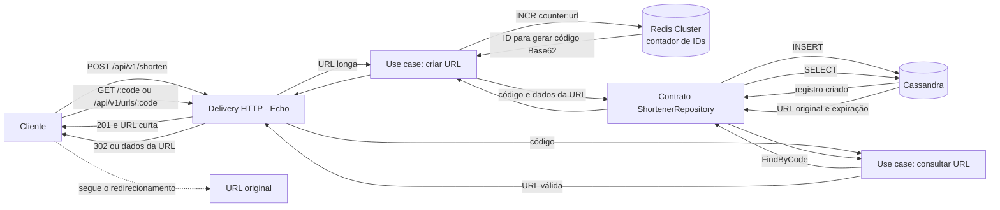

# URL Shortener

Serviço HTTP para criar URLs curtas e redirecionar para os endereços originais. A aplicação usa Go e Echo, Cassandra para persistência e um contador distribuído no Redis Cluster para gerar os códigos.

## Funcionalidades

- Criar uma URL curta a partir de uma URL HTTP ou HTTPS.
- Consultar os dados associados a um código.
- Redirecionar o código curto para a URL original.
- Definir expiração de cinco anos para as URLs criadas.

## API

A aplicação escuta na porta `8080` por padrão. A porta pode ser alterada com a variável `PORT`.

| Método | Endpoint | Comportamento |
| --- | --- | --- |
| `POST` | `/api/v1/shorten` | Cria uma URL curta; recebe `{"url":"https://example.com"}` e responde com `201 Created`. |
| `GET` | `/api/v1/urls/:code` | Retorna os dados da URL associada ao código. |
| `GET` | `/:code` | Procura o código e redireciona com `302 Found`. |

Exemplo de criação:

```http
POST /api/v1/shorten
Content-Type: application/json

{
  "url": "https://example.com/articles/architecture"
}
```

O código é gerado com Sqids e um alfabeto Base62 (`0-9`, `a-z`, `A-Z`). URLs inválidas ou códigos fora do formato aceito são rejeitados.

## Arquitetura e fluxo de dados

O projeto segue uma organização inspirada em arquitetura hexagonal/limpa:

- **Delivery** (`shortener/delivery`): adaptador HTTP em Echo; registra rotas, valida entradas e monta respostas.
- **Use cases** (`shortener/usecase`): implementa a criação e a consulta de URLs.
- **Domain e entity** (`shortener/domain`, `shortener/entity`): regras de validação, geração de código e modelo da URL.
- **Repository** (`shortener/repository`): contrato de persistência usado pelos casos de uso.
- **Infrastructure** (`infrastructure/cassandra`): implementação do repositório em Cassandra.
- **Composition root** (`app/main.go`): conecta as dependências e inicia a API.




### Persistência e geração dos códigos

- O Redis Cluster mantém o contador `counter:url`; o código gerado é persistido junto com a URL original, data de criação e expiração.
- O código usa Sqids com alfabeto Base62. O contador começa em `14.000.000`, visando iniciar códigos com aproximadamente quatro caracteres.
- O Cassandra é acessado por meio da interface `ShortenerRepository`, permitindo substituir a implementação de persistência sem alterar as rotas HTTP.

**Limitação arquitetural:** o caso de uso de criação instancia diretamente o cliente Redis e contém os endereços dos nós (`localhost:7000` a `localhost:7005`). Portanto, a abstração por interfaces ainda não cobre a geração de IDs; mover essa integração para um adaptador/porta reduziria o acoplamento.

## Requisitos e estado atual

Os números abaixo são objetivos do projeto, não resultados de testes de carga ou garantias operacionais.

| Objetivo | Estado observado |
| --- | --- |
| 100 milhões de URLs por dia e disponibilidade 24/7 | Não demonstrados pelo compose atual: há apenas um nó Cassandra configurado e o keyspace usa fator de replicação `1`. |
| Relação de aproximadamente 10 leituras para cada gravação | É uma premissa de dimensionamento; não há cache de leitura implementado. |
| Armazenamento por pelo menos cinco anos | O caso de uso define expiração em cinco anos, mas o schema inicial precisa ser alinhado com o código (ver aviso abaixo). |
| Códigos curtos com caracteres alfanuméricos | Sqids usa um alfabeto Base62; o código também é validado para ter entre 4 e 12 caracteres. |

## Execução local

O `docker-compose.yml` inicia a infraestrutura de desenvolvimento (Cassandra e os seis nós do Redis Cluster); ele **não** inicia a API.

```sh
docker compose up -d
go run ./app
```

O processo da API deve rodar na máquina host para usar os endereços Redis `localhost:7000`–`localhost:7005` definidos no código. A conexão Cassandra aceita `CASSANDRA_HOST` (padrão `localhost`), `CASSANDRA_KEYSPACE` (padrão `application`), `CASSANDRA_USERNAME` e `CASSANDRA_PASSWORD`.

> **Atenção ao schema:** `docker/init.cql` cria `short_urls` sem a coluna `expires_at`, mas o repositório da aplicação inclui essa coluna nos comandos `INSERT` e `SELECT`. Em uma inicialização limpa pelo compose, alinhe o schema antes de testar as operações da API.

O `main.go` na raiz inicia apenas um servidor Echo de exemplo (“Hello, World!”); o ponto de entrada do encurtador é `app/main.go`.

## Compose e operação

- **Cassandra 5.0:** volume nomeado `cassandra_data`; o compose configura um único nó. O keyspace criado pelo script inicial usa `SimpleStrategy` com fator de replicação `1`, adequado a desenvolvimento, não a uma implantação de alta disponibilidade.
- **Redis 7.4:** seis nós com persistência AOF e diretórios locais em `data/redisnode*`; o serviço `redis-cluster-init` cria o cluster com uma réplica por primário.
- **Inicialização do schema:** `cassandra-init` aguarda o healthcheck do Cassandra e executa `docker/init.cql`.
- **API:** não há serviço da aplicação no compose; ela é iniciada separadamente com `go run ./app`.

## Próximos passos

- Alinhar `docker/init.cql` ao schema usado pelo repositório, incluindo `expires_at`.
- Tornar o Redis configurável e acessá-lo por uma abstração própria.
- Definir uma topologia Cassandra com replicação e nós suficientes para os objetivos de disponibilidade e escala.
- Avaliar cache para códigos acessados com frequência e instrumentação de analytics.
